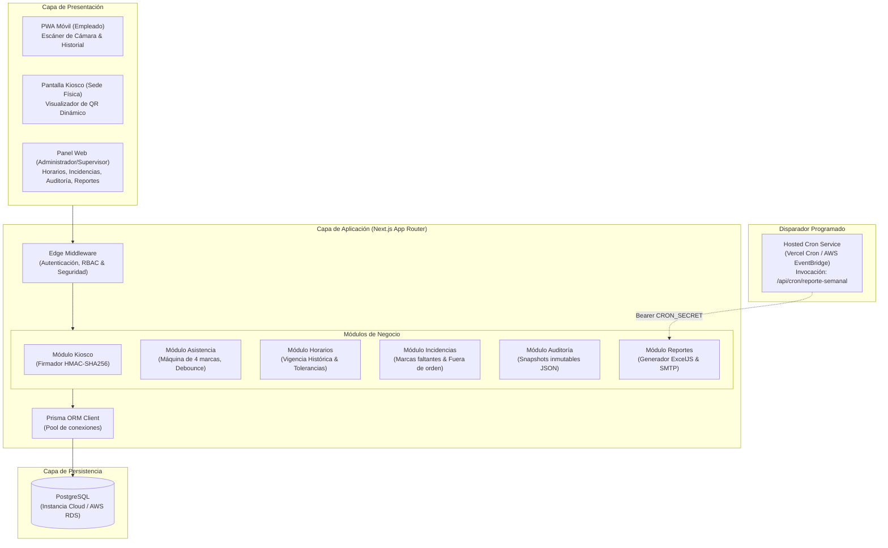
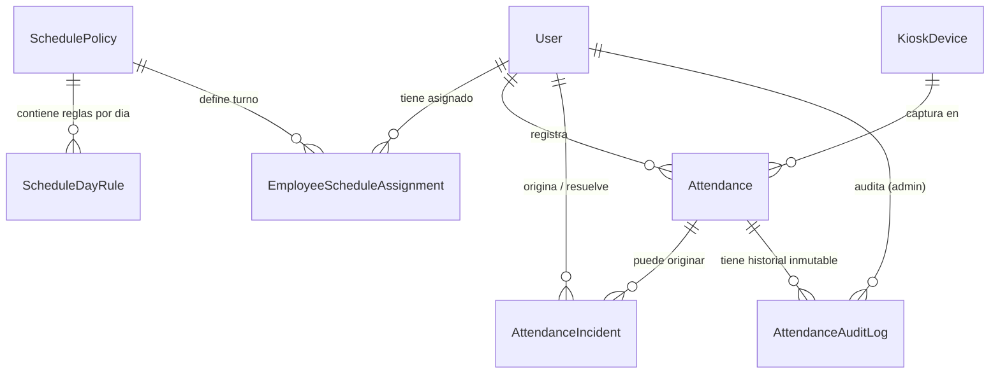

# Arquitectura Técnica — INTECOAL Asistencia

---

## 1. Visión General del Sistema

El sistema **INTECOAL Asistencia** está concebido bajo una arquitectura desacoplada, modular y nativa de nube utilizando el framework **Next.js (App Router)** en TypeScript, con persistencia en **PostgreSQL** a través de **Prisma ORM**.

---

## 2. Componentes y Módulos de la Aplicación

### 2.1. Módulo de Autenticación y Control de Acceso (`src/modules/auth`)
- **Sesiones:** Basadas en tokens JWT seguros en cookies con flags `HttpOnly`, `SameSite=Lax` y `Secure`.
- **RBAC (Role-Based Access Control):**
  - Rutas `/admin/*`: Exclusivas para roles `ADMIN` y `SUPERVISOR`.
  - Rutas `/empleado/*`: Exclusivas para rol `EMPLEADO`.
  - Rutas `/kiosco/*`: Para terminales autorizadas con credenciales de `KIOSCO`.

### 2.2. Módulo de Kiosco & QR Dinámico (`src/modules/kiosk`)
- **Terminales Autorizadas:** Cada pantalla debe estar registrada en la base de datos con su identificador `kioskId` y clave secreta propia.
- **Estructura del Token Criptográfico:**
  $$\text{Payload} = \{\text{kioskId}, \text{tokenId}, \text{timestamp}, \text{expiresAt}\}$$
  $$\text{Signature} = \text{HMAC-SHA256}(\text{Payload}, \text{kioskSecret})$$
- **Ciclo de Vida:**
  - El kiosco solicita o genera un nuevo token cada **20 a 30 segundos**.
  - Durante este lapso, el código es visible en pantalla.
  - Varios empleados pueden escanear simultáneamente el mismo código.
  - El servidor valida la vigencia temporal ($\text{tiempoActual} \le \text{expiresAt}$).

### 2.3. Módulo de Asistencia (`src/modules/attendance`)
- **Regla de 4 Marcaciones Diarias:**
  1. `ENTRADA_MANANA`
  2. `SALIDA_ALMUERZO`
  3. `ENTRADA_ALMUERZO`
  4. `SALIDA_JORNADA`
- **Control de Anti-Duplicidad:**
  - Restricción única en base de datos: `@@unique([userId, fecha, tipo])`.
  - Mecanismo de enfriamiento (*cooldown*): Bloquea registros dentro de los 2 minutos siguientes a cualquier marcación previa del mismo usuario.
- **Hora Oficial:**
  - La fecha y hora se toman del servidor de base de datos en UTC y se traducen a `America/Bogota` para determinar fecha calendario y cálculo de retraso.

### 2.4. Módulo de Horarios con Vigencia Histórica (`src/modules/schedules`)
- Permite que las políticas de turno evolucionen sin corromper el cálculo de asistencias pasadas.
- Cada asignación (`EmployeeScheduleAssignment`) cuenta con:
  - `validFrom`: Fecha de inicio del horario.
  - `validUntil`: Fecha de fin del horario (o `NULL` si está vigente de forma indefinida).
- Cuando el motor evalúa una marcación del día $D$, selecciona la política donde:
  $$validFrom \le D \quad \text{y} \quad (validUntil \ge D \lor validUntil \text{ es NULL})$$

### 2.5. Módulo de Incidencias Operativas (`src/modules/incidents`)
- Identifica anomalías sin interrumpir la operación:
  - `FUERA_DE_SECUENCIA`: Se registra una marca saltando el flujo lógico diario.
  - `MARCACION_FALTANTE`: Se detecta al cierre de la jornada que el colaborador no completó sus 4 registros.
- Mantiene las incidencias en estado `PENDIENTE` hasta que un administrador o supervisor aplique una resolución justificada.

### 2.6. Módulo de Auditoría (`src/modules/audit`)
- Garantiza inmutabilidad y cumplimiento legal:
  - Ningún registro de marcación se elimina mediante `DELETE`.
  - Toda modificación genera una fila en `AttendanceAuditLog` conteniendo:
    - Identificador de la marcación y del administrador.
    - Motivo justificado obligatorio.
    - Snapshot JSON de los valores antes de la edición.
    - Snapshot JSON de los valores resultantes.
    - Dirección IP y estampa de tiempo oficial del servidor.

### 2.7. Módulo de Reportes y Tareas Programadas (`src/modules/reports`)
- **Generación de Excel:** Emplea `exceljs` para producir archivos enriquecidos con encabezados corporativos, matrices de asistencia diaria, indicadores de retardo y hojas de incidencias/auditoría.
- **Despacho Automático:**
  - Endpoint seguro: `/api/cron/reporte-semanal`.
  - Requiere cabecera: `Authorization: Bearer <CRON_SECRET>`.
  - Disparado semanalmente (viernes en la tarde) mediante cron en la nube.
  - Envío por correo vía SMTP corporativo o servicio transaccional.

---

## 3. Modelo de Base de Datos (Diseño Relacional en Prisma)

### Detalle de Entidades Principales
1. **`users`:** Empleados, supervisores, administradores y terminales del sistema.
2. **`kiosk_devices`:** Terminales físicas autorizadas con llaves HMAC propias.
3. **`schedule_policies`:** Políticas de turno con parámetros de tolerancia configurables.
4. **`schedule_day_rules`:** Reglas estructuradas por día de la semana (Lunes a Domingo) con horas de las 4 marcas.
5. **`employee_schedule_assignments`:** Asignaciones de turno con vigencia histórica (`validFrom`, `validUntil`).
6. **`attendances`:** Registros de asistencia con restricción anti-duplicidad `(userId, fechaLaboral, tipo)` e `idempotencyKey`.
7. **`attendance_incidents`:** Gestión de anomalías operativas (marcas faltantes o fuera de secuencia).
8. **`attendance_audit_logs`:** Trazabilidad inmutable de correcciones con snapshots JSON de valores previos y nuevos.

---

## 4. Estrategia de Manejo de Zona Horaria

Para garantizar coherencia absoluta entre el registro, la visualización y los reportes:
1. **Almacenamiento:** Los campos `DateTime` en PostgreSQL se persisten en formato estándar UTC.
2. **Cómputo:** Las funciones del módulo `src/lib/date-utils.ts` emplean `date-fns-tz` forzando la zona horaria `America/Bogota` (UTC-5):
   - Conversión de rangos de entrada/salida.
   - Determinación del día calendario oficial del registro.
   - Cálculo de minutos de retardo y tolerancia.

---

## 5. Preparación para Despliegue en AWS

El proyecto está diseñado para facilitar su despliegue futuro en servicios de **Amazon Web Services (AWS)**:
- **Cómputo:**
  - Opción A: Contenedor Docker en **AWS ECS Fargate** o **AWS App Runner** para alta disponibilidad sin gestión de servidores.
  - Opción B: Despliegue serverless vía **AWS Lambda** (con adaptadores de Next.js / OpenNext) o **Vercel** conectado a recursos AWS.
- **Base de Datos:** **Amazon RDS para PostgreSQL** o **Amazon Aurora Serverless**, con backups automáticos y Multi-AZ opcional.
- **Tareas Programadas:** **Amazon EventBridge Scheduler** invocando de manera segura el endpoint del reporte semanal cada viernes.
- **Almacenamiento de Archivos:** **Amazon S3** para resguardo histórico de los libros Excel generados.
- **Correo Electrónico:** **Amazon SES (Simple Email Service)** para entrega de reportes por correo.

