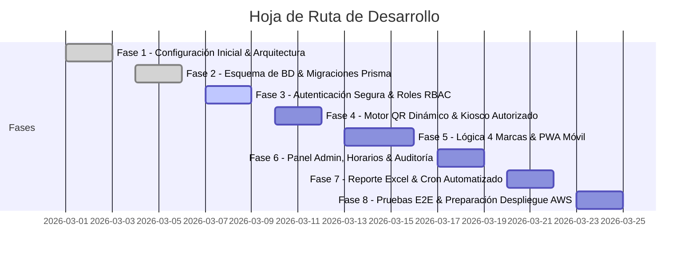

# Estado del Proyecto — INTECOAL Asistencia

---

## 1. Ficha del Proyecto

| Parámetro | Detalle |
| :--- | :--- |
| **Nombre del Proyecto** | INTECOAL Asistencia |
| **Organización** | INTECOAL S.A.S. |
| **Versión Actual** | `0.2.0` (Fase 2 Completada) |
| **Fecha de Inicio** | Marzo de 2026 |
| **Zona Horaria Oficial** | `America/Bogota` (UTC-5) |
| **Estado Actual** | **Fase 2: Diseño de Base de Datos Concluida (Listo para Fase 3)** |

---

## 2. Bitácora de Fases y Avance

---

## 3. Entregables Concluidos en la Fase 1

- [x] Inicialización del proyecto Next.js con App Router y TypeScript en la raíz `intecoal-asistencia`.
- [x] Configuración de Tailwind CSS v4 para estilizado ágil.
- [x] Instalación y fijación de versión LTS de **Prisma ORM (`v6.19.3`)** y `@prisma/client`.
- [x] Instalación de utilidades críticas: `date-fns`, `date-fns-tz` (bloqueadas para `America/Bogota`), `zod`, `lucide-react`, `clsx`, `tailwind-merge`.
- [x] Inicialización de repositorio local Git independiente (`main`) con `.gitignore` estricto que protege archivos de entorno y secretos.
- [x] Creación de plantilla de variables de entorno `.env.example`.
- [x] Estructuración modular de directorios en `src/`.
- [x] Página de bienvenida corporativa (`src/app/page.tsx`).
- [x] Creación de los 6 documentos de continuidad fundamentales.
- [x] Verificación de compilación exitosa (`npm run build`).

---

## 4. Entregables Concluidos en la Fase 2 (Diseño de Base de Datos)

- [x] Diseño e implementación exhaustiva del esquema en `prisma/schema.prisma` con soporte para:
  - 4 marcaciones diarias (`ENTRADA_MANANA`, `SALIDA_ALMUERZO`, `ENTRADA_ALMUERZO`, `SALIDA_JORNADA`).
  - Roles separados (`ADMIN`, `SUPERVISOR`, `EMPLEADO`, `KIOSCO`).
  - Horarios con vigencia histórica (`EmployeeScheduleAssignment` con `validFrom` y `validUntil`).
  - Parámetros de tolerancia configurables por turno o empleado.
  - Modelo fuertemente tipado para días laborales lunes a viernes (`ScheduleDayRule`).
  - Restricción anti-duplicidad compuesta `(userId, fechaLaboral, tipo)` e `idempotencyKey`.
  - Inmutabilidad de marcaciones originales y tabla de auditoría estricta (`AttendanceAuditLog`) con snapshots JSON.
  - Registro de incidencias (`AttendanceIncident`) por marcas fuera de secuencia o faltantes sin invención de datos.
- [x] Validación sintáctica y semántica del esquema (`npx prisma validate`).
- [x] Generación del cliente tipado de Prisma (`npx prisma generate`).
- [x] Generación del script de migración SQL DDL inicial (`prisma/migrations/0_init/migration.sql`).
- [x] Creación del script de sembrado inicial (`prisma/seed.ts`) con datos 100% ficticios.
- [x] Creación y ejecución exitosa de pruebas de tipos y contratos (`src/__tests__/schema-verification.ts`).
- [x] Verificación de compilación integral del proyecto (`npm run build`).
  1. `README.md`
  2. `CONTEXTO_EMPRESA.md`
  3. `REQUISITOS.md`
  4. `ARQUITECTURA.md`
  5. `REGLAS_ASISTENCIA.md`
  6. `ESTADO_PROYECTO.md`
- [x] Verificación de compilación exitosa (`npm run build`).

---

## 4. Registro de Decisiones Técnicas (ADR)

1. **ADR-01: Selección de Prisma 6.19.3 en lugar de versiones release candidate preliminares:**
   - *Decisión:* Se fijó Prisma en su versión LTS probada 6.19.3, garantizando estabilidad total en las migraciones de PostgreSQL y herramientas del CLI (`prisma generate`, `prisma migrate`).
2. **ADR-02: Manejo de Zona Horaria Centralizado:**
   - *Decisión:* Todo cálculo de fecha local se realiza con `date-fns-tz` forzando `America/Bogota`, mientras que la persistencia en base de datos se mantiene en UTC universal.
3. **ADR-03: Modularización de Dominio en `src/modules/`:**
   - *Decisión:* Aislar la lógica de negocio (asistencia, horarios, kiosco, auditoría, reportes) de las rutas del App Router para facilitar pruebas unitarias y extensiones futuras.

---

## 5. Próximos Pasos (Fase 2)

Al recibir la autorización formal para la **Fase 2**, se desarrollarán las siguientes actividades:
1. Implementación del esquema completo en `prisma/schema.prisma` (modelos `User`, `KioskDevice`, `SchedulePolicy`, `EmployeeScheduleAssignment`, `Attendance`, `AttendanceIncident`, `AttendanceAuditLog`).
2. Generación del cliente de Prisma y creación de la primera migración de base de datos.
3. Creación del script de sembrado inicial (`prisma/seed.ts`) con políticas base de turnos y usuario administrador de prueba (con datos simulados, sin datos reales de empleados).

